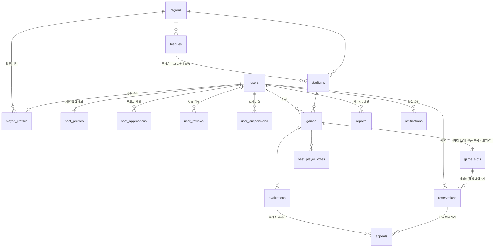

# ERD

> 기준: PRD v2.6, 정책 명세서 v0.2
> 상태: **상세안**. 정책 명세서 v0.2 기준 (경기 자리 22개 구조, 경기 시간 2~3시간, 끌어올리기). 아직 `[제안]` 인 항목은 제안 값으로 작성했다. `[미결]` 항목은 어느 쪽으로 정해져도 스키마를 바꾸지 않거나, 하위 호환 변경(컬럼·값 추가)만으로 대응할 수 있게 했다 (8장).

## 1. 설계 원칙

| 항목      | 규칙                                                                                                                                                           |
| --------- | -------------------------------------------------------------------------------------------------------------------------------------------------------------- |
| 위치      | Prisma 스키마(`schema.prisma`)는 `apps/server`에만 둔다. 상태·코드 enum은 `packages/shared`에도 정의해 web 과 같은 값을 쓴다 (값 일치는 테스트로 확인)         |
| 이름      | 테이블·컬럼은 `snake_case` (Prisma 모델은 `PascalCase`·`camelCase` + `@@map`/`@map`). 테이블 이름은 복수형                                                     |
| ID        | `uuid` (v7, 시간순 정렬). URL 에 노출되는 ID 로 순번 추측을 막는다. 지역만 표준 코드를 PK 로 쓴다                                                              |
| 시각      | 모두 `timestamptz`. 표시·계산은 KST (PRD 비기능 요구사항)                                                                                                      |
| 상태      | 상태 전이는 `apps/server` 도메인 서비스에서만 한다. 전이는 `WHERE id = ? AND status = ?` 조건부 업데이트로 경합에 안전하게 한다                                |
| 저장/파생 | 시간이 지나면 저절로 바뀌는 값(경기 모집 상태 등)과 다른 테이블로 셀 수 있는 값(참가·노쇼 횟수 등)은 **저장하지 않고 계산**한다 (6장). 정합성이 깨질 일이 없다 |
| 스키마    | 변경은 `prisma migrate` 마이그레이션으로만 (`prisma db push` 미사용), 하위 호환 방식                                                                           |
| 제약      | Prisma 스키마로 표현할 수 없는 제약(부분 unique 인덱스, check)은 마이그레이션 SQL 에 직접 작성한다 (7장)                                                       |
| 응답      | DTO 로 매핑한다. 계좌번호·휴대폰 번호·노쇼 상세는 필요한 화면에만 노출 (정책 3.3)                                                                              |

## 2. 관계도

## 3. Enum

| Enum                 | 값                                                                                                               | 근거                               |
| -------------------- | ---------------------------------------------------------------------------------------------------------------- | ---------------------------------- |
| `UserRole`           | `PLAYER` `HOST` `ADMIN`                                                                                          | 정책 2.2                           |
| `PhoneSource`        | `KAKAO` `MANUAL`                                                                                                 | 정책 2.3                           |
| `Position`           | `SP` `RP` `C` `FIRST_BASE` `SECOND_BASE` `THIRD_BASE` `SS` `LF` `CF` `RF` `DH`                                   | 정책 5장 (식별자는 `1B` 대신 영문) |
| `TeamSide`           | `FIRST` `SECOND`                                                                                                 | 선공 / 후공 (정책 5장)             |
| `Grade`              | `DIV_1` `DIV_2` `DIV_3` `DIV_4` `ROOKIE`                                                                         | 정책 4장                           |
| `ReviewStatus`       | `PENDING` `APPROVED` `REJECTED`                                                                                  | 구장 등록 요청, 주최자 신청        |
| `GameStatus`         | `SCHEDULED` `CANCELLED`                                                                                          | 정책 6.3 (나머지는 파생, 6장)      |
| `GameCancelReason`   | `RAIN` `STADIUM` `LACK_OF_PLAYERS` `OTHER`                                                                       | 정책 9.2                           |
| `ReservationStatus`  | `RESERVED` `PAYMENT_SUBMITTED` `APPROVED` `EXPIRED` `CANCELLED` `REJECTED` `GAME_CANCELLED` `ATTENDED` `NO_SHOW` | PRD 6장                            |
| `ExpireReason`       | `PAYMENT_TIMEOUT` `APPROVAL_TIMEOUT`                                                                             | PRD 6장 `EXPIRED` ①②               |
| `UserReviewReason`   | `NO_SHOW_THRESHOLD`                                                                                              | D14 (사유 추가 가능)               |
| `UserReviewStatus`   | `PENDING` `SUSPENDED` `DISMISSED`                                                                                | D14                                |
| `SuspensionSource`   | `NO_SHOW_REVIEW` `REPORT` `ADMIN`                                                                                | 정책 2.4, 11.1, 13.1               |
| `ReportReason`       | `BAD_MANNER` `ABUSE` `FALSE_INFO` `FRAUD` `OTHER`                                                                | 정책 13.1                          |
| `ReportStatus`       | `PENDING` `WARNED` `SUSPENDED` `DISMISSED`                                                                       | 정책 13.1                          |
| `AppealType`         | `NO_SHOW` `EVALUATION`                                                                                           | 정책 13.2                          |
| `AppealStatus`       | `PENDING` `ACCEPTED` `REJECTED`                                                                                  | 정책 13.2                          |
| `NotificationType`   | 4.5 참고                                                                                                         | P0-6·10·12·14, 정책 9~12장         |
| `NotificationStatus` | `PENDING` `SENT` `FAILED` `SKIPPED`                                                                              | `SKIPPED`: 휴대폰 번호 없음        |

활성 예약 = `RESERVED` `PAYMENT_SUBMITTED` `APPROVED` (정책 1.2). enum 값 추가는 하위 호환이지만 삭제·이름 변경은 아니다.

## 4. 테이블

표기: **PK**, FK → 대상, `?` = NULL 허용. 모든 테이블에 `created_at timestamptz default now()`, 수정되는 테이블에는 `updated_at` 이 있다 (표에서는 생략).

### 4.1 계정

**`users`** — 카카오 계정 1개 = 사용자 1명

| 컬럼          | 타입          | 규칙                                                               |
| ------------- | ------------- | ------------------------------------------------------------------ |
| **id**        | uuid          |                                                                    |
| kakao_id      | text          | unique. 카카오 회원번호                                            |
| roles         | `UserRole[]`  | 기본 `{PLAYER}`. 주최자 승인 시 `HOST` 추가, 관리자는 DB 에서 직접 |
| phone?        | text          | 알림톡 수신 번호. 숫자만 저장                                      |
| phone_source? | `PhoneSource` | `phone` 이 있으면 필수 (check)                                     |

- 정지 여부는 컬럼이 아니라 `user_suspensions` 로 판단한다 (4.1 마지막 표).
- 탈퇴(`[미결]`)는 결정 후 `withdrawn_at` 등을 추가한다 (8장).

**`player_profiles`** — 선수 카드 (users 1:1). **행이 있으면 필수 항목을 다 채운 것**이다 (정책 2.1 예약 차단 판단).

| 컬럼            | 타입         | 규칙                                                |
| --------------- | ------------ | --------------------------------------------------- |
| **user_id**     | uuid         | PK, FK → users                                      |
| nickname        | text         | unique. 2~10자, 한글·영문·숫자 (형식은 앱에서 검증) |
| region_code     | char(5)      | FK → regions                                        |
| main_position   | `Position`   |                                                     |
| sub_positions   | `Position[]` | 0~2개, `main_position` 미포함 (check)               |
| grade           | `Grade`      |                                                     |
| is_former_pro   | boolean      | 기본 false. 선수 출신 (정책 4장)                    |
| gameone_url?    | text         | 허용 도메인 검증은 앱에서                           |
| uniqueplay_url? | text         |                                                     |

**`host_applications`** — 주최자 신청 (정책 2.2)

| 컬럼           | 타입           | 규칙                           |
| -------------- | -------------- | ------------------------------ |
| **id**         | uuid           |                                |
| user_id        | uuid           | FK → users                     |
| contact_phone  | text           |                                |
| leagues_note   | text           | 운영하는 리그·구장 (자유 입력) |
| status         | `ReviewStatus` | 기본 `PENDING`                 |
| reviewed_by?   | uuid           | FK → users (관리자)            |
| reviewed_at?   | timestamptz    |                                |
| reject_reason? | text           |                                |

- 사용자당 `PENDING` 신청은 1개 (부분 unique).

**`host_profiles`** — 주최자 기본 입금 계좌. 다음 경기 개설 때 미리 채운다 (정책 6.1)

| 컬럼           | 타입 | 규칙           |
| -------------- | ---- | -------------- |
| **user_id**    | uuid | PK, FK → users |
| bank_name      | text |                |
| account_number | text | 숫자·하이픈만  |
| account_holder | text |                |

**`user_reviews`** — 노쇼 2회 도달 시 관리자 검토 대상 (D14, 정책 11.1)

| 컬럼        | 타입               | 규칙                |
| ----------- | ------------------ | ------------------- |
| **id**      | uuid               |                     |
| user_id     | uuid               | FK → users          |
| reason      | `UserReviewReason` |                     |
| status      | `UserReviewStatus` | 기본 `PENDING`      |
| decided_by? | uuid               | FK → users (관리자) |
| decided_at? | timestamptz        |                     |
| note?       | text               |                     |

- 사용자당 `PENDING` 검토는 1개 (부분 unique). 이의제기로 노쇼가 취소돼 조건에서 벗어나면 `DISMISSED` 로 닫는다 (정책 11.2).

**`user_suspensions`** — 정지 이력. 한 번 정지 = 한 행

| 컬럼            | 타입               | 규칙                                                             |
| --------------- | ------------------ | ---------------------------------------------------------------- |
| **id**          | uuid               |                                                                  |
| user_id         | uuid               | FK → users                                                       |
| source          | `SuspensionSource` |                                                                  |
| user_review_id? | uuid               | FK → user_reviews                                                |
| report_id?      | uuid               | FK → reports                                                     |
| reason          | text               | 사용자에게 보여줄 사유 (정책 2.4)                                |
| starts_at       | timestamptz        |                                                                  |
| ends_at?        | timestamptz        | **NULL = 관리자가 해제할 때까지** (정지 기간 `[미결]` 양쪽 대응) |
| lifted_at?      | timestamptz        | 조기 해제                                                        |
| created_by      | uuid               | FK → users (관리자)                                              |

- **정지 중** = `starts_at <= now() AND (ends_at IS NULL OR ends_at > now()) AND lifted_at IS NULL` 인 행이 있음.

### 4.2 지역·리그·구장

**`regions`** — 시/군/구 표준 코드 (D2)

| 컬럼      | 타입    | 규칙                                |
| --------- | ------- | ----------------------------------- |
| **code**  | char(5) | 행정표준코드 시군구 5자리           |
| sido      | text    | 예: 경기도                          |
| sigungu   | text    | 예: 수원시 영통구                   |
| is_active | boolean | 기본 false. 서비스 지역만 true (D1) |

**`leagues`**

| 컬럼        | 타입    | 규칙                      |
| ----------- | ------- | ------------------------- |
| **id**      | uuid    |                           |
| region_code | char(5) | FK → regions              |
| name        | text    | unique(region_code, name) |

**`stadiums`** — 구장은 리그 1개에만 소속 (D10)

| 컬럼           | 타입           | 규칙                                                 |
| -------------- | -------------- | ---------------------------------------------------- |
| **id**         | uuid           |                                                      |
| league_id      | uuid           | FK → leagues                                         |
| region_code    | char(5)        | FK → regions. 지역 필터용                            |
| name           | text           | unique(league_id, name)                              |
| address?       | text           |                                                      |
| status         | `ReviewStatus` | 시드는 `APPROVED`. 주최자 요청은 `PENDING` 으로 시작 |
| requested_by?  | uuid           | FK → users. NULL = 관리자 시드                       |
| reviewed_by?   | uuid           | FK → users                                           |
| reviewed_at?   | timestamptz    |                                                      |
| reject_reason? | text           |                                                      |

- 경기 개설은 `APPROVED` 구장만 (앱에서 검증).

### 4.3 경기

**`games`** — 경기 1회. 더블헤더는 경기 2개로 나눠 만들고 `series_id` 로 묶는다

| 컬럼                  | 타입               | 규칙                                                                                    |
| --------------------- | ------------------ | --------------------------------------------------------------------------------------- |
| **id**                | uuid               |                                                                                         |
| host_id               | uuid               | FK → users                                                                              |
| stadium_id            | uuid               | FK → stadiums                                                                           |
| series_id?            | uuid               | 더블헤더 묶음. 같은 값이면 같은 날 연속 경기                                            |
| series_no?            | smallint           | 1경기·2경기. `series_id` 와 함께 있거나 함께 NULL (check). unique(series_id, series_no) |
| starts_at             | timestamptz        | 개설 시점 + 3시간 이후 (앱에서 검증)                                                    |
| ends_at               | timestamptz        | `ends_at - starts_at` 이 **2~3시간, 10분 단위** (check). 기본값 시작 + 2시간 (앱)       |
| fee                   | integer            | 0~100,000, 1,000원 단위 (check)                                                         |
| allowed_grades        | `Grade[]`          | 1개 이상 (check)                                                                        |
| allows_former_pro     | boolean            | 기본 true                                                                               |
| notice?               | text               | 500자 이내 (check)                                                                      |
| bank_name             | text               | 개설 시점 계좌 **스냅샷**. 주최자가 기본 계좌를 바꿔도 이 경기는 그대로                 |
| account_number        | text               |                                                                                         |
| account_holder        | text               |                                                                                         |
| status                | `GameStatus`       | 기본 `SCHEDULED`                                                                        |
| bumped_at             | timestamptz        | 목록 정렬 기준. 개설 시각으로 시작하고 **끌어올리기** 때 갱신 (정책 6.4)                |
| cancel_reason?        | `GameCancelReason` | `status = CANCELLED` 이면 필수 (check)                                                  |
| cancel_reason_detail? | text               | `OTHER` 이면 필수 (check)                                                               |
| cancelled_at?         | timestamptz        | `status = CANCELLED` 이면 필수 (check)                                                  |

인덱스: `(bumped_at)` 목록 정렬, `(starts_at)` 날짜 필터, `(stadium_id, starts_at)` 리그·구장별 일정, `(host_id, starts_at)` 내 경기

**`game_slots`** — 경기 자리. 경기를 만들 때 **선공·후공 × 포지션 11개 = 22행을 항상 함께 만든다**. 자리마다 1명이며 동시 예약의 락 대상이다

| 컬럼       | 타입        | 규칙                                                                           |
| ---------- | ----------- | ------------------------------------------------------------------------------ |
| **id**     | uuid        |                                                                                |
| game_id    | uuid        | FK → games                                                                     |
| side       | `TeamSide`  |                                                                                |
| position   | `Position`  | unique(game_id, side, position)                                                |
| closed_at? | timestamptz | 주최자가 **마감**한 자리 (앱 밖에서 사람을 구함). NULL 이면 모집 중 (정책 6.4) |

- `unique(id, game_id)`: `reservations` 가 자리와 경기를 함께 참조해, 다른 경기의 자리를 가리키지 못하게 한다.
- 활성 예약이 있는 자리는 마감할 수 없다 (앱에서 락 후 검증, 5.2).

### 4.4 예약

**`reservations`** — 용병 1명이 자리 1개를 잡은 기록

| 컬럼                  | 타입                | 규칙                                                                        |
| --------------------- | ------------------- | --------------------------------------------------------------------------- |
| **id**                | uuid                |                                                                             |
| game_id               | uuid                | FK → games. `(game_slot_id, game_id)` → game_slots(id, game_id)             |
| game_slot_id          | uuid                |                                                                             |
| user_id               | uuid                | FK → users                                                                  |
| status                | `ReservationStatus` | 기본 `RESERVED`                                                             |
| depositor_name        | text                | 2~20자 (check)                                                              |
| reserved_at           | timestamptz         |                                                                             |
| payment_deadline_at   | timestamptz         | `min(reserved_at + 24h, games.starts_at)` 를 예약 시 계산해 저장 (정책 8장) |
| payment_submitted_at? | timestamptz         |                                                                             |
| approved_at?          | timestamptz         |                                                                             |
| rejected_at?          | timestamptz         |                                                                             |
| cancelled_at?         | timestamptz         | 사용자 취소·경기 취소                                                       |
| cancel_reason?        | text                | 사용자 취소 사유 (선택, 정책 9.1)                                           |
| expired_at?           | timestamptz         |                                                                             |
| expire_reason?        | `ExpireReason`      | `status = EXPIRED` 이면 필수 (check)                                        |
| attendance_marked_at? | timestamptz         | 참가 완료·노쇼 처리 시각. 48시간 내 수정 가능 (정책 10.3)                   |
| attendance_auto       | boolean             | 기본 false. 48시간 미처리 자동 `ATTENDED` (정책 10.2)                       |

제약·인덱스

- **부분 unique** `(game_slot_id) WHERE status IN ('RESERVED','PAYMENT_SUBMITTED','APPROVED')`: **자리 1개에 활성 예약 1개**. 마지막 자리 동시 예약에서 1명만 성공하는 것을 DB 가 보장한다 (P0-3)
- **부분 unique** `(game_id, user_id) WHERE status IN (활성)`: 같은 경기 활성 예약 1개 (P0-3)
- `(user_id, status)`: 내 예약 목록, 같은 시간대 예약 확인
- **부분 인덱스** `(payment_deadline_at) WHERE status = 'RESERVED'`: 입금 기한 만료 Cron
- 거절 후 재예약 불가(정책 7.3)는 앱에서 `REJECTED` 이력을 확인한다.

### 4.5 경기 후

**`evaluations`** — 같은 경기 `ATTENDED` 용병끼리 (정책 12장)

| 컬럼         | 타입     | 규칙                                            |
| ------------ | -------- | ----------------------------------------------- |
| **id**       | uuid     |                                                 |
| game_id      | uuid     | FK → games                                      |
| evaluator_id | uuid     | FK → users                                      |
| target_id    | uuid     | FK → users. `evaluator_id` 와 달라야 함 (check) |
| manner       | smallint | 1~5 (check)                                     |
| skill_match  | smallint | 1~5 (check)                                     |
| punctuality  | smallint | 1~5 (check)                                     |

- unique(game_id, evaluator_id, target_id). 제출 후 수정 불가. 대상 자격(둘 다 `ATTENDED`, 참가자 4명 이상, 7일 기한)은 앱에서 검증.

**`best_player_votes`**

| 컬럼         | 타입 | 규칙                                        |
| ------------ | ---- | ------------------------------------------- |
| **game_id**  | uuid | PK, FK → games                              |
| **voter_id** | uuid | PK, FK → users. 경기당 1인 1표              |
| target_id    | uuid | FK → users. `voter_id` 와 달라야 함 (check) |

**`reports`** — 신고 (정책 13.1)

| 컬럼           | 타입           | 규칙                          |
| -------------- | -------------- | ----------------------------- |
| **id**         | uuid           |                               |
| reporter_id    | uuid           | FK → users                    |
| target_user_id | uuid           | FK → users. 본인 불가 (check) |
| game_id        | uuid           | FK → games                    |
| reason         | `ReportReason` |                               |
| detail?        | text           |                               |
| status         | `ReportStatus` | 기본 `PENDING`                |
| handled_by?    | uuid           | FK → users                    |
| handled_at?    | timestamptz    |                               |
| handle_note?   | text           | 내부 메모 (비공개)            |

**`appeals`** — 이의제기 (정책 13.2)

| 컬럼            | 타입           | 규칙                                                                 |
| --------------- | -------------- | -------------------------------------------------------------------- |
| **id**          | uuid           |                                                                      |
| user_id         | uuid           | FK → users                                                           |
| type            | `AppealType`   |                                                                      |
| reservation_id? | uuid           | FK → reservations. `type = NO_SHOW` 이면 필수, 아니면 NULL (check)   |
| evaluation_id?  | uuid           | FK → evaluations. `type = EVALUATION` 이면 필수, 아니면 NULL (check) |
| reason          | text           |                                                                      |
| status          | `AppealStatus` | 기본 `PENDING`                                                       |
| handled_by?     | uuid           | FK → users                                                           |
| handled_at?     | timestamptz    |                                                                      |
| handle_note?    | text           |                                                                      |

- 대상별 `PENDING` 이의제기는 1개 (부분 unique).

### 4.6 알림

**`notifications`** — 알림톡 발송 로그 겸 중복 방지

| 컬럼            | 타입                 | 규칙                                                   |
| --------------- | -------------------- | ------------------------------------------------------ |
| **id**          | uuid                 |                                                        |
| user_id         | uuid                 | FK → users                                             |
| type            | `NotificationType`   |                                                        |
| dedupe_key      | text                 | **unique**. 예: `PAYMENT_DEADLINE_1H:<reservation_id>` |
| reservation_id? | uuid                 | FK → reservations                                      |
| game_id?        | uuid                 | FK → games                                             |
| payload         | jsonb                | 템플릿 변수                                            |
| status          | `NotificationStatus` | 기본 `PENDING`                                         |
| sent_at?        | timestamptz          |                                                        |
| error?          | text                 |                                                        |

- Cron 은 advisory lock 으로 한 인스턴스만 돌지만(infra 3.6), `dedupe_key` unique 가 마지막 방어선이다. 발송 전에 행을 먼저 넣고, 충돌하면 보내지 않는다.

`NotificationType` 값

| 값                      | 받는 사람 | 시점                                 |
| ----------------------- | --------- | ------------------------------------ |
| `PAYMENT_DEADLINE_12H`  | 용병      | 입금 기한 12시간 전 (P0-10)          |
| `PAYMENT_DEADLINE_1H`   | 용병      | 입금 기한 1시간 전 (P0-10)           |
| `RESERVATION_APPROVED`  | 용병      | 승인 (P0-6)                          |
| `RESERVATION_REJECTED`  | 용병      | 거절                                 |
| `RESERVATION_EXPIRED`   | 용병      | 만료                                 |
| `APPROVAL_REMINDER`     | 주최자    | `PAYMENT_SUBMITTED` 후 4시간 (D7)    |
| `RESERVATION_CANCELLED` | 주최자    | 입금 후·승인 후 용병 취소 (정책 9.1) |
| `GAME_CANCELLED`        | 용병      | 경기 취소 (P0-12)                    |
| `ATTENDANCE_REMINDER`   | 주최자    | 자동 참가 완료 6시간 전 (정책 10.2)  |
| `EVALUATION_OPENED`     | 용병      | 평가 화면 열림 (정책 12.2)           |
| `REPORT_RESOLVED`       | 신고자    | 신고 처리 결과 (정책 13.1)           |

## 5. 동시성·정합성

### 5.1 예약 (P0-3)

한 트랜잭션에서 아래 순서로 락을 잡는다. **모든 경로에서 순서를 지켜** 데드락을 막는다.

1. `users` 행 `FOR UPDATE`: 같은 사용자의 예약 요청을 한 줄로 세운다. 서로 다른 두 경기를 동시에 예약해 **같은 시간대 차단을 우회하는 경우**를 막는다.
2. `games` 행 `FOR SHARE`: 예약과 경기 취소가 겹치지 않게 한다 (경기 취소는 `FOR UPDATE`).
3. `game_slots` 행 `FOR UPDATE`: 같은 자리 예약과 자리 마감을 한 줄로 세운다.
4. 검증: 경기 상태·마감(시작 2시간 전), 자리 마감 여부, 자리 활성 예약 없음, 선수 카드·정지·급수·선수 출신·본인 경기, 같은 경기 활성 예약 없음, 거절 이력 없음, **같은 시간대 활성 예약 없음** (`g.starts_at < 새 경기 ends_at AND g.ends_at > 새 경기 starts_at`. 더블헤더 1·2경기처럼 끝과 시작이 맞닿으면 겹치지 않는다)
5. `INSERT reservations` (`payment_deadline_at` 계산). 부분 unique 위반은 "이미 마감된 자리" / "이미 예약함"으로 처리한다.

락으로 막고, 부분 unique 로 한 번 더 막는다. 락이 빠진 코드 경로가 생겨도 자리 1개에 2명이 들어가지는 않는다.

### 5.2 상태 전이

- 모든 전이는 `UPDATE reservations SET status = :to, ... WHERE id = :id AND status = :from` 이고, 바뀐 행이 0이면 "이미 처리됨"으로 응답한다. Cron 과 사용자 동작이 겹쳐도 한쪽만 성공한다.
- 만료 Cron
  - 입금 기한: `WHERE status = 'RESERVED' AND payment_deadline_at <= now()` → `EXPIRED` (`PAYMENT_TIMEOUT`)
  - 미승인: `status = 'PAYMENT_SUBMITTED'` 이고 경기 `starts_at <= now()` → `EXPIRED` (`APPROVAL_TIMEOUT`)
  - 자동 참가 완료: `status = 'APPROVED'` 이고 경기 `ends_at + 48h <= now()` → `ATTENDED`, `attendance_auto = true`
- 경기 취소: `games` 행 `FOR UPDATE` → `status = CANCELLED` → 활성 예약 전부 `GAME_CANCELLED`
- 자리 마감·해제(정책 6.4): `game_slots` 행 `FOR UPDATE` 후 활성 예약이 없을 때만 `closed_at` 을 바꾼다.
- 끌어올리기: `games.bumped_at = now()` (간격 제한은 앱에서, 정책 6.4).

## 6. 저장하지 않고 계산하는 값

| 값                        | 계산                                                                                                               |
| ------------------------- | ------------------------------------------------------------------------------------------------------------------ |
| 경기 모집 상태 (정책 6.3) | `CANCELLED` → 종료 시각 지남 `FINISHED` → 시작 2시간 전 지남 `CLOSED` → 모든 자리가 예약 또는 마감 `FULL` → `OPEN` |
| 자리 상태 (P0-2)          | 자리별 `APPROVED` 확정 / `RESERVED`·`PAYMENT_SUBMITTED` 입금대기 / `closed_at` 마감 / 그 외 빈자리                 |
| 참가 횟수                 | 내 `ATTENDED` 예약 수                                                                                              |
| 노쇼 횟수                 | 내 `NO_SHOW` 예약 수. 소멸 정책(`[미결]`)이 정해지면 기간 조건만 추가한다                                          |
| 평균 평가 점수            | 받은 `evaluations` 평균. 5건 이상일 때 공개 (정책 12.3)                                                            |
| 베스트플레이어 횟수       | 경기별 최다 득표자 수                                                                                              |
| 정지 여부                 | 4.1 `user_suspensions` 조건                                                                                        |

- 베타 규모(경기당 자리 22개, 사용자 수백 명)에서는 인덱스로 충분하다. 느려지면 그때 집계 컬럼이나 뷰를 추가한다.
- 이의제기로 노쇼가 취소되면 예약 상태를 `ATTENDED` 로 고치는 것만으로 노쇼 횟수가 자동으로 맞는다 (정책 11.2).

## 7. 마이그레이션 SQL 로 직접 추가하는 제약

Prisma 스키마로 표현하지 못해 초기 마이그레이션 SQL 에 직접 쓴다.

- 부분 unique: `reservations(game_id, user_id)` 활성 / `host_applications(user_id)` PENDING / `user_reviews(user_id)` PENDING / `appeals(reservation_id)`, `appeals(evaluation_id)` PENDING
- 부분 인덱스: `reservations(payment_deadline_at) WHERE status = 'RESERVED'`
- check: 4장 표의 `(check)` 항목 전부

## 8. 미결 정책 대응

| 정책 (`[미결]`)              | 대응                                                                                                                                            |
| ---------------------------- | ----------------------------------------------------------------------------------------------------------------------------------------------- |
| 탈퇴 시 노쇼 이력 보관 (2.5) | A: 개인정보 컬럼 비우기 + `withdrawn_at` 추가. B: `withdrawn_identities(kakao_id_hash, no_show_count, expires_at)` 테이블 추가. 둘 다 하위 호환 |
| 노쇼 정지 기간 (11.2)        | `user_suspensions.ends_at` NULL(영구) / 값(기간제) 모두 지원. 변경 불필요                                                                       |
| 노쇼 횟수 소멸 (11.2)        | 노쇼 횟수가 계산 값이라 조회 조건만 바꾼다. 변경 불필요                                                                                         |
| 주최자 취소 이력 공개 (9.2)  | `games.status = CANCELLED` 로 집계. 변경 불필요                                                                                                 |
| 지역별 급수 명칭 (4장)       | 명칭은 표시용이라 `Grade` 값은 그대로 두고 표시만 바꾼다. 값이 늘면 enum 추가                                                                   |
| 이의제기 SLA (13.2)          | `appeals.created_at` 으로 측정. 변경 불필요                                                                                                     |

## 9. 범위 밖

- refresh 토큰 저장: 카카오 로그인 이슈에서 추가
- 대기열(P1-2), 팔로우(P2-1), 채팅(MVP 이후)
